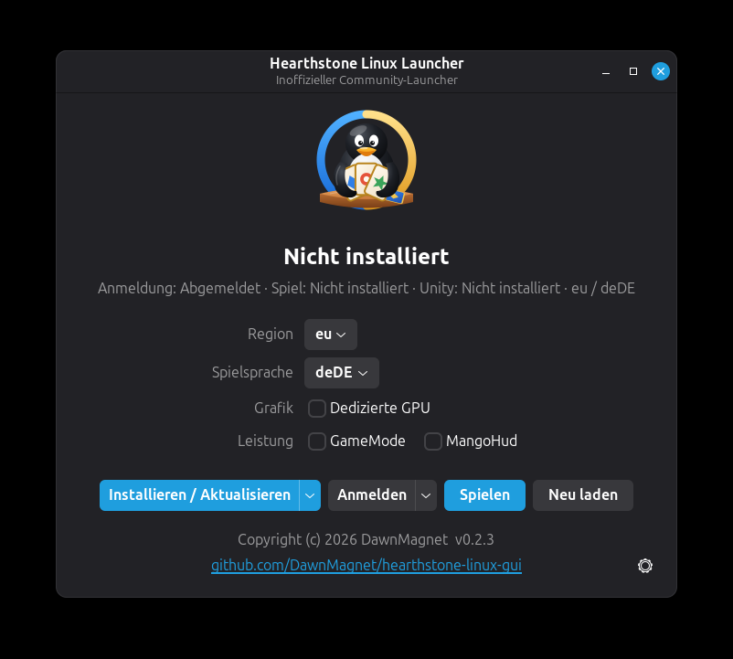

# hearthstone-linux-gui

<p align="center">
  
</p>

<p align="center">
  <a href="README.md">English README</a>
  ·
  <a href="README.cn.md">中文说明</a>
  ·
  <a href="https://github.com/DawnMagnet/hearthstone-linux-gui/releases/latest">Neueste Version</a>
</p>

**hearthstone-linux-gui** ist ein nativer GTK4-Desktop-Manager, mit dem sich
Hearthstone unter Linux installieren, aktualisieren, anmelden und starten
lässt. Er ist aus dem ursprünglichen Projekt
[`hearthstone-linux`](https://github.com/0xf4b1/hearthstone-linux)
hervorgegangen; der frühere skriptgesteuerte Ablauf wurde durch eine
paketierte Rust-Anwendung mit grafischer Oberfläche ersetzt.

Für die normale Nutzung ist kein Terminal nötig. Lade eine Version herunter,
installiere oder öffne sie über deine Desktop-Umgebung, klicke auf
**Installieren / Aktualisieren**, dann auf **Anmelden** und schließlich auf
**Spielen**.

## Was sich gegenüber dem ursprünglichen Projekt geändert hat

Das ursprüngliche `hearthstone-linux` hat gezeigt, dass Hearthstone unter
Linux läuft, wenn man Blizzards offizielle Spieldateien mit der
Linux-Laufzeit von Unity kombiniert. Dieses Projekt behält die Idee bei und
macht daraus eine Desktop-Anwendung, die sich leichter verteilen und pflegen
lässt.

| Ursprüngliches `hearthstone-linux` | Dieses Projekt |
| --- | --- |
| Einrichtung über Skripte | Desktop-Anwendung mit GTK4/libadwaita |
| Manueller Ablauf auf der Kommandozeile | Installieren, Anmelden, Aktualisieren und Starten per Schaltfläche |
| Python/Bash-Werkzeuge werden vorausgesetzt | Paketierte Laufzeit; für die normale Nutzung ist weder Python noch Bash nötig |
| Externer Downloader `keg` | Nativer NGDP-Downloader in Rust mit Cache und Prüfung |
| Mühsame Einrichtung je Distribution | AppImage, DEB, RPM, Flatpak und natives Nix-Paket |

## Auf einen Blick

- **Bedienung per Klick**: Installieren, Aktualisieren, Anmelden und Starten
  aus einem GTK4-Fenster.
- **Übersetzte Oberfläche**: Englisch, Deutsch und vereinfachtes Chinesisch;
  der Launcher folgt der Systemsprache und lässt sich über das Zahnradmenü
  unten rechts umstellen.
- **GameMode und MangoHud**: Optionale Schalter starten das Spiel über
  `gamemoderun` und mit dem MangoHud-Overlay, sofern beides installiert ist.
- **Editor für Spieleinstellungen**: Bildratenbegrenzung, VSync und
  Grafikqualität ändern oder `options.txt` und zusätzliche
  `client.config`-Einträge bearbeiten, alles über das Zahnradmenü.
- **Kein Terminal nötig**: Die Release-Pakete sind für die grafische
  Installation und den täglichen Gebrauch gedacht.
- **Keine Python/Bash-Laufzeit nötig**: Der Launcher ist eine native
  Rust-Binärdatei und bringt die benötigten Bibliotheken mit.
- **Pakete für viele Distributionen**: NixOS, Debian, Ubuntu, Fedora und
  andere x86_64-Linux-Distributionen.
- **Portables AppImage**: GTK und Laufzeitschicht sind enthalten; glibc und
  Treiber kommen vom System (glibc ≥ 2.34).
- **Natives Nix-Paket** mit Desktop-Integration.
- **DEB/RPM-Installer** für gängige Desktop-Distributionen.
- **Fortsetzbare Downloads**: Ein unterbrochener Download der Unity-Laufzeit
  wird an der abgebrochenen Stelle fortgesetzt.
- **Zwischengespeicherte Spieldaten**: Heruntergeladene NGDP-Inhalte werden
  gespeichert und geprüft, um unnötige Netzwerkzugriffe zu vermeiden.
- **Keine Steam-Abhängigkeit**: Das Spiel wird mit der projekteigenen
  Laufzeitbehandlung gestartet, nicht über `steam-run`.

## Pakete

| Paket | Geeignet für | Nutzung |
| --- | --- | --- |
| **AppImage** | Jeden x86_64-Linux-Desktop mit glibc 2.34 oder neuer | Herunterladen und direkt öffnen |
| **DEB** | Debian, Ubuntu, Linux Mint, Pop!_OS und verwandte Systeme | Mit der grafischen Softwareverwaltung öffnen |
| **RPM** | Fedora, RHEL-kompatible Systeme, openSUSE | Mit der grafischen Softwareverwaltung öffnen |
| **Flatpak** | Jede Distribution mit Flatpak, auch unveränderliche (Bazzite, Silverblue, SteamOS) und Systeme mit glibc älter als 2.34 | `flatpak install --user ./hearthstone-linux-gui-*-x86_64.flatpak` |
| **Nix** | NixOS und Nutzer des Nix-Paketmanagers | Natives Paket mit Desktop-Datei und Launcher |

### Systemvoraussetzungen

Alle Release-Artefakte werden auf der ältesten noch unterstützten
Distribution gebaut, die GTK 4 und libadwaita mitbringt: Enterprise Linux 9
(glibc 2.34). Sie laufen deshalb auf alten wie auf neuen Systemen.

| | Minimum |
| --- | --- |
| CPU | x86_64 |
| glibc | **2.34** (RHEL/AlmaLinux/Rocky 9, Ubuntu 22.04, Debian 12, Fedora 35, openSUSE Leap 15.6/16 und neuer) |
| GTK / libadwaita (DEB/RPM/Pacman) | GTK 4.0, libadwaita 1.0, GLib 2.66 aus der Distribution |
| GTK / libadwaita (AppImage) | Enthalten (GTK 4.12, libadwaita 1.4); glibc, Grafiktreiber, Schriften und X11/Wayland kommen vom System |
| Flatpak | Nur Flatpak selbst; die GNOME-51-Laufzeit (mit eigener glibc und eigenem GTK) wird von Flathub installiert |

Unter NixOS nimmst du das Nix-Paket (siehe unten); das AppImage braucht dort
`programs.nix-ld` oder `appimage-run`. Ältere Systeme wie Ubuntu 20.04,
Debian 11 oder RHEL 8 werden nicht unterstützt, weil sie kein GTK 4
mitbringen.

AppImage und die DEB/RPM/Pacman-Pakete stammen aus einem gemeinsamen
Container-Build (`packaging/linux/Dockerfile`); das Nix-Paket baut der Flake.
Siehe [`docs/design/packaging-pipeline.md`](docs/design/packaging-pipeline.md)
und [`packaging/README.md`](packaging/README.md).

### Pakete selbst bauen

```sh
# deb + rpm + pacman + AppImage → dist/
packaging/appimage/build.sh

# nur das AppImage
TARGET=appimage-out packaging/appimage/build.sh
```

Das AppImage wird mit fest versionierten Werkzeugen (**linuxdeploy**,
**appimagetool**, **type2-runtime**) zusammengestellt. Es enthält
GTK/libadwaita/GLib aus EL9, aber **nie** die glibc, und es setzt kein
`LD_LIBRARY_PATH` (Bibliotheken werden über `RUNPATH` gefunden). Die nativen
Pakete linken gegen das GTK des Systems. Die CI
(`.github/workflows/packaging.yml`) prüft jedes Artefakt auf AlmaLinux 9,
Ubuntu 22.04/24.04, Debian 12/13, Fedora, Arch und openSUSE Tumbleweed.

## Installation

1. Öffne die
   [Seite der neuesten Version](https://github.com/DawnMagnet/hearthstone-linux-gui/releases/latest).
2. Lade das Paket herunter, das zu deinem System passt.
3. Öffne es über deine Desktop-Umgebung:
   - AppImage: Öffne die heruntergeladene Datei. Falls der Dateimanager
     nachfragt, aktiviere in den Dateieigenschaften „Als Programm ausführen“.
   - DEB/RPM: Doppelklicke auf das Paket und installiere es über die
     grafische Softwareverwaltung.
   - Flatpak: `flatpak install --user ./hearthstone-linux-gui-*-x86_64.flatpak`
     (Flathub wird für die GNOME-Laufzeit automatisch hinzugefügt), danach
     `flatpak run io.github.hearthstone_linux_gui`. Spieldateien und
     Einstellungen liegen unter
     `~/.var/app/io.github.hearthstone_linux_gui/`.
   - Nix/NixOS: Installiere das native Nix-Paket auf deinem gewohnten Weg.
4. Starte **hearthstone-linux-gui** aus dem Anwendungsmenü.

Danach ist der normale Ablauf:

1. **Region** und **Spielsprache** wählen. Beim ersten Start sind beide
   anhand der Systemsprache vorausgewählt.
2. Auf **Installieren / Aktualisieren** klicken.
3. Auf **Anmelden** klicken und die Battle.net-Anmeldung im Browser
   abschließen.
4. Zurück in der App auf **Spielen** klicken.

Die App speichert Nutzerdaten in den üblichen XDG-Verzeichnissen im
Home-Verzeichnis. Unterbrochene Unity-Downloads werden automatisch
fortgesetzt, und bereits heruntergeladene Spieldaten werden nach Möglichkeit
wiederverwendet.

## Nix, NixOS und Home Manager

Dieses Repository ist ein Flake für `x86_64-linux`. Es stellt Paket-, App-
und Entwicklungs-Shell-Ausgaben bereit, aber keine eigenen Module für NixOS
oder Home Manager. Nimm die Paketausgabe in deine System- oder
Home-Paketliste auf.

Die Anwendung direkt von GitHub starten:

```sh
nix run github:DawnMagnet/hearthstone-linux-gui
```

Aus einem lokalen Checkout bauen:

```sh
nix build .#default
nix build .#runtime
```

| Ausgabe | Zweck |
| --- | --- |
| `packages.x86_64-linux.default` | Natives Nix-Paket des GTK-Launchers |
| `packages.x86_64-linux.runtime` | FHS-Laufzeit-Wrapper, über den der heruntergeladene Unity-Player gestartet wird |
| `apps.x86_64-linux.default` | Einstiegspunkt für `nix run` |
| `devShells.x86_64-linux.default` | Entwicklungs-Shell für Rust/GTK |

Vollständige Flake-Beispiele für NixOS (`environment.systemPackages`) und
Home Manager (`home.packages`) stehen im
[englischen README](README.md#nix-nixos-and-home-manager); der Code ist
sprachunabhängig.

## Funktionsweise

Hearthstone verteilt seine offiziellen Daten über Blizzards NGDP-System. Das
Spiel ist mit Unity gebaut, und der Linux-Player von Unity kann die
Spieldaten ausführen, sobald die Verzeichnisstruktur angepasst ist.

Der Launcher automatisiert diesen Vorgang:

1. Er lädt die offiziellen Hearthstone-Spieldaten für die gewählte Region
   und Sprache herunter.
2. Er prüft die heruntergeladenen Inhalte und legt sie im Cache ab.
3. Er baut die macOS-Verzeichnisstruktur in eine für Linux passende um.
4. Er ermittelt die benötigte Unity-Version und installiert den passenden
   Linux-Player.
5. Er installiert Kompatibilitätsdateien und die Konfiguration, die das
   Spiel braucht.
6. Er registriert den Handler für die Anmelde-Rückmeldung und speichert das
   Token verschlüsselt auf dem Rechner.
7. Er startet das Spiel in einer kontrollierten Linux-Laufzeitumgebung.

Weder in diesem Repository noch in den Launcher-Paketen liegen proprietäre
Hearthstone-Dateien. Die Anwendung holt die offiziellen Dateien während der
Installation von den Verteilservern des Herstellers.

## Stand und Einschränkungen

- Zielarchitektur: **x86_64 Linux**.
- Der Spielclient läuft, das Projekt ist aber inoffiziell.
- Der Ingame-Shop steht je nach Verhalten der Gegenseite möglicherweise
  nicht zur Verfügung.
- Nutzung auf eigene Gefahr. Dieses Projekt steht in keiner Verbindung zu
  Blizzard Entertainment.

## Fehlerbehebung

| Symptom | Abhilfe |
| --- | --- |
| Die App zeigt **Anmeldung erforderlich** | Erneut auf **Anmelden** klicken und den Ablauf im Browser abschließen (siehe [Anmeldung im Browser](#anmeldung-im-browser)). |
| `--write-token` meldet ein ungültiges Token-Format | Regionspräfix und beide Bindestriche beibehalten (`XX-<32 Zeichen>-<Konto-ID>`); die Länge der Konto-ID ist je Konto verschieden. |
| Das Spiel trennt die Battle.net-Verbindung mit TLS-Fehlern | Siehe [Zertifikatsfehler auf Rolling-Release-Distributionen](#zertifikatsfehler-auf-rolling-release-distributionen). |
| Das Spielfenster ist beim Start weiß oder flackert | Siehe [Weißer Bildschirm auf manchen AMD-GPUs](#weißer-bildschirm-auf-manchen-amd-gpus). |
| Die Installation wurde unterbrochen | Erneut auf **Installieren / Aktualisieren** klicken; fortsetzbare und zwischengespeicherte Downloads werden wiederverwendet. |
| Das Spiel startet nach einem Update nicht | Einmal auf **Installieren / Aktualisieren** klicken, um Unity- und Laufzeitdateien zu reparieren. |
| Das Spiel beendet sich sofort mit `Unable to load mono library` (NixOS-Flake) | Den Flake aktualisieren; die FHS-Umgebung enthält inzwischen `zlib`, das die mitgelieferte Mono-Laufzeit braucht. |
| Ein Paket lässt sich öffnen, startet auf einer ungewöhnlichen Distribution aber nicht | Das AppImage probieren (enthält GTK, nutzt die glibc des Systems). |

### Anmeldung im Browser

Ein Klick auf **Anmelden** registriert den Launcher als System-Handler für
das URL-Schema `blizzard-hearthstone://` und öffnet die
Battle.net-Anmeldeseite. Nach der Anmeldung leitet der Browser auf dieses
Schema um, und der Launcher schreibt das Anmeldetoken automatisch; Kopieren
ist nicht nötig. Das Token liegt verschlüsselt unter
`<Spielverzeichnis>/token`.

Zeigt der Browser stattdessen `http://localhost:0/...` mit dem Fehler
`ERR_UNSAFE_PORT` (Chrome) oder `NS_ERROR_PORT_ACCESS_NOT_ALLOWED`
(Firefox), wurde der Handler nicht registriert, oder deine Version ist älter
als die Korrektur dieses Fehlers. Die Anmeldung lässt sich dann von Hand
abschließen:

1. Kopiere den Wert des Parameters `ST=` aus der blockierten URL (alles nach
   `ST=` bis zum nächsten `&`).
2. Führe aus:
   ```sh
   hearthstone-linux-gui --write-token 'US-xxxxxxxxxxxxxxxxxxxxxxxxxxxxxxxx-1234567'
   ```
   Mit dem AppImage: `./hearthstone-linux-gui_*.AppImage --write-token '...'`.
   Es funktioniert auch, die gesamte fehlgeschlagene URL an
   `--auth-callback` zu übergeben.

Ein gültiges Token besteht aus einem zweistelligen Regionspräfix, einem
Bindestrich, 32 alphanumerischen Zeichen, einem Bindestrich und deiner
numerischen Konto-ID. Lehnt der Befehl den Wert weiterhin ab, prüfe, ob das
Regionspräfix beim Kopieren verloren gegangen ist.

### Zertifikatsfehler auf Rolling-Release-Distributionen

Startet das Spiel, kann sich aber nicht bei Battle.net anmelden, und steht in
`~/.config/unity3d/Blizzard Entertainment/Hearthstone/Player.log` oder
`<Spielverzeichnis>/Logs/**/BattleNet.log` eine der Meldungen
`Curl error 35 ... UnityTls error code: 7`,
`Ssl error ... CERTIFICATE_VERIFY_FAILED` oder
`ERROR_SDK_SOCKET_CLOSED (1901)`, dann findet das Spiel den
Zertifikatsspeicher des Systems nicht. Der Unity-Player enthält fest
eingetragene Pfade der CA-Bündel von Debian und RHEL, die es auf openSUSE und
einigen anderen Rolling-Release-Distributionen nicht gibt. Diskussion dazu im
ursprünglichen Projekt:
[0xf4b1/hearthstone-linux#108](https://github.com/0xf4b1/hearthstone-linux/issues/108).

Unter openSUSE Tumbleweed:

```sh
# 1) Die CA-Bündel an den Pfaden bereitstellen, die der Unity-Player erwartet (einmalig, mit root-Rechten)
sudo ln -sf /var/lib/ca-certificates/ca-bundle.pem /etc/ssl/certs/ca-bundle.crt
sudo ln -sf /var/lib/ca-certificates/ca-bundle.pem /etc/ssl/certs/ca-certificates.crt

# 2) Die Systemzertifikate in den Benutzerspeicher von Mono importieren
#    (cert-sync gehört zum Paket mono-core der Distribution)
cert-sync --user /etc/ssl/certs/ca-bundle.crt
```

Meldet `BattleNet.log` weiterhin eine fehlende `libmono-btls-shared.so`,
kopiere diese Bibliothek aus dem Paket `mono-core` deiner Distribution nach
`<Spielverzeichnis>/Bin/Hearthstone_Data/MonoBleedingEdge/x86_64/` und starte
mit `MONO_TLS_PROVIDER=btls`.

### Weißer Bildschirm auf manchen AMD-GPUs

Auf manchen integrierten AMD-GPUs (zum Beispiel Rembrandt / Radeon 680M)
bleibt das Spielfenster weiß und flackert, während `Player.log` die Meldung
`ERROR: Shader Hidden/Universal Render Pipeline/DBufferClear shader is not
supported on this GPU` enthält. Den für Linux umgepackten Spieldaten fehlen
die Shader-Varianten, die diese Funktionsstufen brauchen; der Launcher kann
das zur Laufzeit nicht beheben. Der Fehler wird in
[#13](https://github.com/DawnMagnet/hearthstone-linux-gui/issues/13)
verfolgt. Einen anderen Renderer zu erzwingen (`-force-glcore`,
`-force-vulkan`) hilft nicht, die Option **Dedizierte GPU** im Launcher
möglicherweise schon.

Release-Builds protokollieren standardmäßig auf der Stufe INFO. Ausführliche
Diagnoseprotokolle lassen sich beim lokalen Debuggen über die übliche
Umgebungsvariable `RUST_LOG` einschalten.

## Übersetzungen

Die Texte der Oberfläche liegen in `locales/<Sprache>.toml` und werden in die
Binärdatei einkompiliert; Englisch (`en.toml`) ist Basis und Fallback. Für
eine neue Sprache kopierst du `en.toml`, übersetzt die Werte und trägst die
Datei in `src/i18n.rs` ein. `cargo test` meldet fehlende, unbekannte und
ungenutzte Schlüssel sowie Platzhalter, die vom englischen Katalog abweichen.

## Rechtlicher Hinweis

Hearthstone, Battle.net, Blizzard Entertainment und die zugehörigen Namen,
Marken, Spielinhalte, Dienste und sonstigen Materialien gehören Blizzard
Entertainment, Inc. oder deren verbundenen Unternehmen und Lizenzgebern.

Dieses Projekt ist ein inoffizieller Kompatibilitäts-Launcher. Es wird weder
von Blizzard Entertainment, Battle.net, Microsoft, Activision Blizzard noch
von einem ihrer verbundenen Unternehmen hergestellt, veröffentlicht,
gesponsert, genehmigt, empfohlen, gepflegt oder unterstützt. Weder in diesem
Repository noch in den Launcher-Paketen liegen proprietäre
Hearthstone-Spielinhalte.

Die vollständigen rechtlichen Informationen, die Grenzen des Projekts, die
Pflichten der Nutzer und das Verfahren für Anfragen von Rechteinhabern stehen
in [LEGAL.md](LEGAL.md) (englisch und chinesisch).
